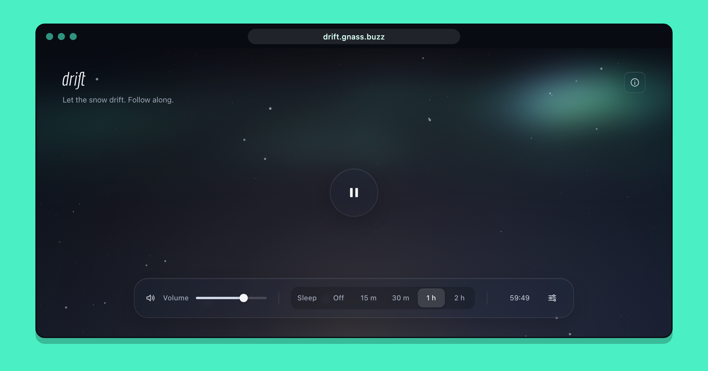

# drift

A blizzard outside your window, synthesized live. Made to help you relax
and drift off to sleep.

**https://drift.gnass.buzz/**



## What it does

- **Synthesized sound.** The storm is not a recording. It is generated in
  real time from noise, filters and random events, so it never loops. The
  timings and depths come from an analysis of a 10 h blizzard recording.
- **A living scene.** Snow, northern lights and the reflection of a candle
  follow the sound: howling voices color the sky, gusts sweep the snow, the
  candle flickers in a draft. The scene stands still while the sound is
  paused.
- **Sleep timer.** The sound and the scene fade out together over the last
  third of the timer.
- **Sound mixer.** Four layers (rumble, wind, howl, snow) with a reset to the
  default mix. Settings are kept in local storage.
- **Installable.** A progressive web app that works offline and plays through
  the iOS mute switch like a music app.

## How it works

The whole blizzard runs in one `AudioWorklet` (`src/blizzard-worklet.js`).
Moving filters glide their coefficients on every sample, which avoids the
buzz that `BiquadFilterNode` makes when its frequency changes. The mixer,
the fixed filters and the limiter run in the same worklet to keep the CPU
load low. The sound has almost nothing above 7 kHz, so the audio context
runs at 24 kHz.

The worklet reports the state of the storm about 15 times per second. The
scene (`src/scene.js`) applies each report when its sound reaches the ear,
after the output latency. The aurora is a flow field drawn one pixel per
tile on a tiny canvas that CSS scales up and blurs.

The wordmark is set in Economica Italic as inline SVG at build time
(`scripts/lettering.mjs`), so the page needs no web font.

## Development

```sh
npm install
npm run dev        # start the dev server
npm run build      # build to dist/
npm run preview    # serve the build
npm test           # run the tests
npm run screenshot # update the screenshots in public/screenshots/
npm run icons      # regenerate the app icons in public/ and public/icons/
```

Built with [Vite](https://vite.dev/) and
[vite-plugin-pwa](https://vite-pwa-org.netlify.app/).

## License

[MIT](LICENSE)
